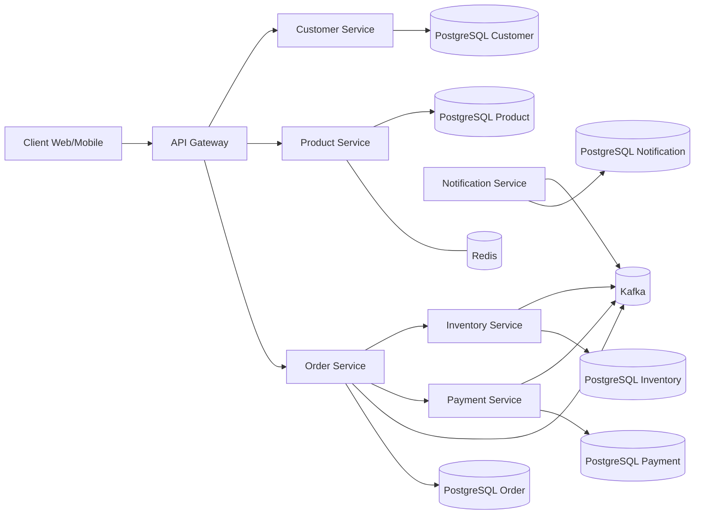

# Enterprise Commerce Platform

Projet **professionnel et pédagogique** pour préparation entretiens **Java Senior / Tech Lead** via une plateforme e-commerce microservices.

## État actuel

- **Phases terminées**: 1 → 7.
- **Implémentation métier**: parcours commande local complet (saga pédagogique + outbox + idempotence consumer).
- **Sécurité/résilience**: API key inter-services + retry exponentiel avec jitter.
- **Observabilité/déploiement**: correlation IDs, endpoint Prometheus, Dockerfiles, manifests Kubernetes, CI GitHub Actions.

## Architecture cible



## Arborescence

```text
.
├── docs/
│   ├── adr/
│   └── *.md
├── infra/
│   └── docker-compose.yml
├── interview-training/
├── k8s/
├── services/
│   ├── api-gateway/
│   ├── customer-service/
│   ├── product-service/
│   ├── order-service/
│   ├── inventory-service/
│   ├── payment-service/
│   └── notification-service/
├── shared/
│   └── common-kernel/
├── PROGRESS.md
└── pom.xml
```

## Stack retenue (incrément actuel)

- Java 21 (compilation), Java 25 (comparaison LTS moderne).
- Spring Boot 3.5.x (ligne stable), Maven multi-modules.
- PostgreSQL, Kafka, Redis, Docker Compose, Kubernetes.
- JUnit 5, Mockito, AssertJ, Testcontainers, WireMock, JaCoCo.

## Documents clés

- `PROGRESS.md`
- `docs/00-learning-roadmap.md`
- `docs/02-architecture-overview.md`
- `docs/03-service-communication.md`
- `docs/04-order-lifecycle.md`
- `docs/12-design-decisions.md`
- `docs/16-java-version-guide.md`
- `docs/adr/*.md`
- `docs/07-security.md`
- `docs/09-observability-and-production.md`
- `docs/11-deployment.md`

## Lancement rapide

```bash
mvn -q test
```

Services actuellement enrichis (métier + tests): `order-service`, `notification-service`.

### Build Docker local (services implémentés)

```bash
mvn -q -pl services/order-service,services/notification-service -am package -DskipTests
docker build -t ecp/order-service:local -f services/order-service/Dockerfile services/order-service
docker build -t ecp/notification-service:local -f services/notification-service/Dockerfile services/notification-service
```
