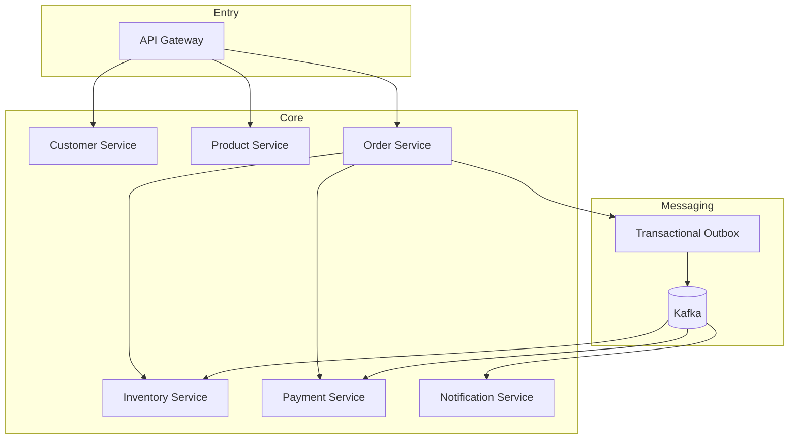

# 02 - Architecture Overview

## Vue d’ensemble

Choix: **microservices ciblés** (7 services) pour matérialiser les frontières métier et les compromis distribués.

## Frontières et responsabilités

- **API Gateway**: authn/authz, routage, rate limiting, corrélation.
- **Customer Service**: cycle de vie client, données personnelles minimisées.
- **Product Service**: catalogue/prix, lecture intensive, cache Redis.
- **Order Service**: orchestration saga, état de commande, compensation.
- **Inventory Service**: réservation/libération stock, anti-survente.
- **Payment Service**: simulation paiement, statuts, rejouabilité.
- **Notification Service**: notifications asynchrones idempotentes.

## Pourquoi ce découpage
- Frontières alignées sur bounded contexts.
- Permet de démontrer couplage faible + cohérence éventuelle.
- Coût assumé: complexité ops, observabilité distribuée, tests E2E plus lourds.
