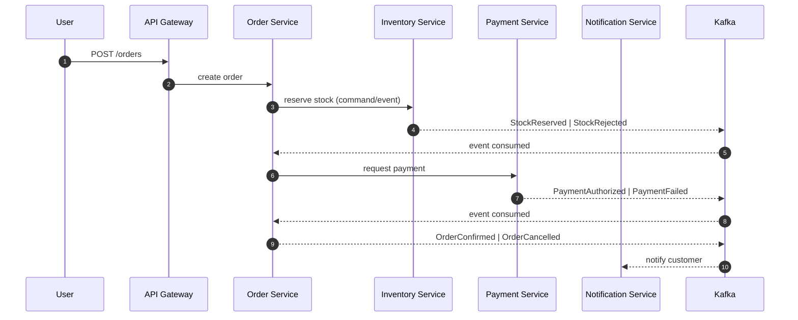

# 04 - Order Lifecycle

## Parcours cible (Saga orchestrée)

## Scénarios d’échec à démontrer
- Stock rejeté -> annulation immédiate.
- Paiement échoué -> compensation stock.
- Timeout paiement -> état intermédiaire + reprise.
- Doublon d’événement -> pas de double transition d’état.

## État implémenté (phase actuelle)

- `order-service` publie désormais un journal d’événements métier interne par commande:
  - `ORDER_CREATED`
  - `STOCK_RESERVED`
  - `PAYMENT_AUTHORIZED`
  - `ORDER_CONFIRMED`
  - `STOCK_RELEASED`
  - `PAYMENT_REFUNDED`
  - `ORDER_CANCELLED`
  - `ORDER_FAILED`
- Endpoint ajouté: `GET /api/orders/{orderId}/events` pour rejouer le cycle d’une commande.
- Cette implémentation reste locale (in-memory) et pédagogique: elle prépare l’introduction Kafka + Outbox de la phase suivante sans prétendre à une durabilité de production.
